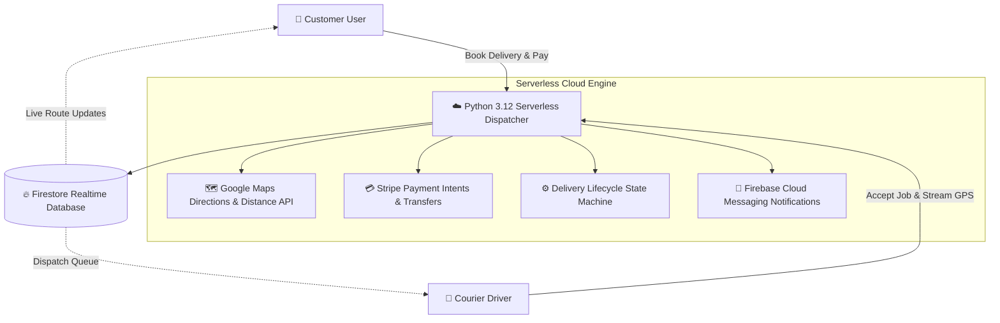

# 📦 DeliverMe — On-Demand Courier Dispatch & Fleet Routing Platform


<p align="center">
  <strong>Full-Stack Real-Time Delivery Dispatching, Dual-Role Mobile Client & Serverless Cloud Routing</strong>
</p>

<p align="center">
  <a href="https://play.google.com/store/apps/details?id=com.delivermee.app">
    
  </a>
  
  
  
  
  
</p>

---

## 🏛️ Engineering Provenance & Production Heritage

> **Production Application Verification:**
> 
> The core logistics dispatch engine, dual-role Flutter architecture, and live Stripe payment settlement system in this repository are actively deployed in production on the **Google Play Store**:
> - 📱 **Live Production Build:** [`com.delivermee.app` on Google Play](https://play.google.com/store/apps/details?id=com.delivermee.app)
> 
> *Notice: This repository consolidates the full-stack logistics architecture titled **DeliverMe** (Flutter Dual-Role Mobile App + Python 3.12 Firebase Cloud Functions backend). All route calculation matrices, state-machine dispatch lifecycles, and payment integrations were designed and authored by **Muhammad Ali** as Principal Mobile Architect.*

---

## 🌟 Executive Overview

**DeliverMe** is an on-demand, last-mile parcel delivery and courier dispatching platform engineered to provide seamless real-time coordination between parcel senders and gig-economy courier drivers.

Operating on a high-concurrency serverless architecture, DeliverMe handles:
1. **Dynamic Fare Calculation:** Real-time distance and transit time calculations via Google Maps Matrix API with vehicle-class adjustments.
2. **Dual-Role Single Client:** Unified Flutter codebase providing distinct tailored experiences for **Customers** and **Courier Drivers** switched automatically via authenticated profile roles.
3. **Automated Stripe Settlement:** Escrow-style payment capture upon booking with automated courier payout transfers and dispute management.
4. **Real-Time GPS Fleet Tracking:** Live location streaming allowing senders and recipients to monitor driver progress on an interactive map.

---

## 🏗️ High-Level System Architecture



---

## 🎯 Technical Capabilities & Feature Breakdown

### 1. 📱 Dual-Role Flutter Mobile Architecture
- **Customer Experience:**
  - Multi-point pickup and dropoff address selection with reverse geocoding.
  - Vehicle class selection (Bike, Sedan, SUV, Cargo Van) with instant upfront pricing.
  - Delivery scheduling (Immediate dispatch vs. Future scheduled slots).
  - In-app live chat between sender and courier.
- **Courier Driver Experience:**
  - Proximity-based job dispatch radar with audio notification triggers.
  - Turn-by-turn navigation integration launching native Google Maps / Apple Maps.
  - Digital proof of delivery (photo capture and customer sign-off).
  - Driver wallet with historical earnings breakdown and Stripe Connect payout tracking.

### 2. ⚡ Python 3.12 Serverless Cloud Backend (`api_v1`)
- 2nd-generation Firebase Cloud Functions running Python 3.12 with 1GB allocated memory.
- Modular architecture with 11 specialized request handlers:
  - `handle_customers()`: Identity verification, customer onboarding, saved addresses.
  - `handle_drivers()`: Driver vetting, document verification, live GPS ping updates.
  - `handle_deliveries()`: Strict state-machine progression (`created` $\rightarrow$ `assigned` $\rightarrow$ `picked_up` $\rightarrow$ `in_transit` $\rightarrow$ `delivered`).
  - `handle_payments()`: Stripe PaymentIntent creation, webhook verification, and automated courier fee splits.
  - `handle_pricing()`: Base fare + per-mile + per-minute + vehicle multiplier formula.

---

## 📂 Repository Layout

```
DeliverMe-Logistics/
├── mobile_app/                 # Flutter Dual-Role Mobile Application
│   ├── lib/
│   │   ├── main.dart           # App entrypoint & role gateway
│   │   ├── firebase_options.dart # Firebase client configuration
│   │   └── src/
│   │       ├── common/         # Shared widgets, themes, network clients
│   │       ├── models/         # User, Driver, Delivery, Car data models
│   │       └── feature/
│   │           ├── auth/       # Multi-role authentication & OTP verification
│   │           ├── user/       # Customer booking, live tracking, payment pages
│   │           └── driver/     # Driver radar, delivery routes, earnings ledger
│   ├── android/                # Native Android host (Kotlin DSL)
│   ├── ios/                    # Native iOS host (CocoaPods)
│   └── pubspec.yaml            # Flutter dependencies
│
├── backend/                    # Python 3.12 Cloud Functions (2nd Gen)
│   ├── main.py                 # api_v1 HTTP Dispatcher & 11 sub-handlers
│   ├── requirements.txt        # Python dependencies (stripe, googlemaps, firebase-admin)
│   ├── .env.example            # Environment variable specification template
│   └── .gcloudignore           # Deployment rules
│
├── assets/                     # Platform logos and diagrams
└── LICENSE                     # MIT Open Source License
```

---

## 🛠️ Technology Stack

| Domain | Technologies |
|---|---|
| **Mobile Client** | Flutter 3.x, Dart 3.x, Google Maps Flutter, Geolocation |
| **Backend Runtime** | Python 3.12 (Firebase Cloud Functions 2nd Generation) |
| **Database & Cache**| Firebase Cloud Firestore, Firebase Storage |
| **Payments** | Stripe API, Stripe Connect (Direct courier payout transfers) |
| **Mapping & Routing**| Google Maps Platform (Directions API, Distance Matrix API, Geocoding) |
| **Notifications** | Firebase Cloud Messaging (FCM), APNs |

---

## 🚀 Getting Started

### 1. Mobile App Setup
```bash
cd mobile_app
flutter pub get
flutter run
```

### 2. Backend Functions Setup
```bash
cd backend
python3 -m venv venv
source venv/bin/activate
pip install -r requirements.txt
cp .env.example .env
# Set your STRIPE_SECRET_KEY and GOOGLE_MAPS_API_KEY
```

---

## 👨‍💻 Author & Lead Mobile Architect

**Muhammad Ali**  
*Full-Stack Mobile Engineer & Solutions Architect*  
- **GitHub:** [@itismemuhammadali](https://github.com/itismemuhammadali)  
- **Email:** [itismemuhammadali@gmail.com](mailto:itismemuhammadali@gmail.com)  

---

## 📄 License
This project is licensed under the [MIT License](LICENSE).
